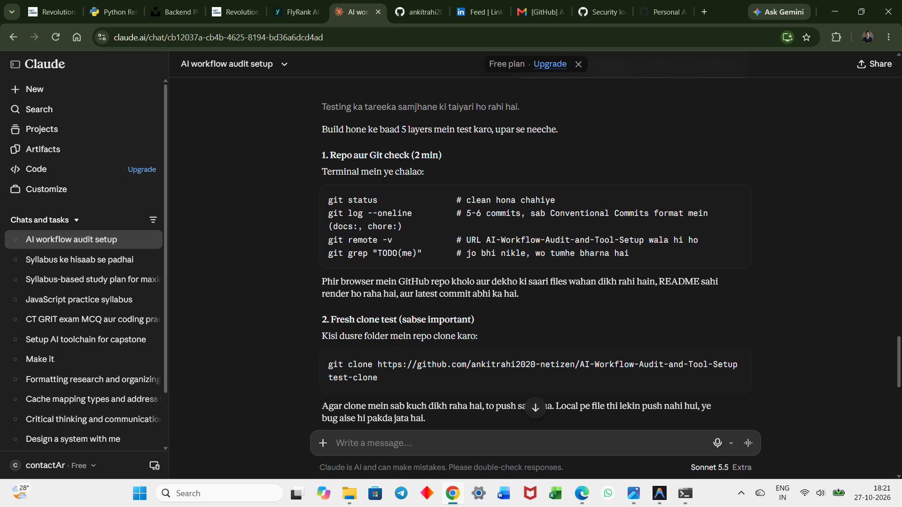
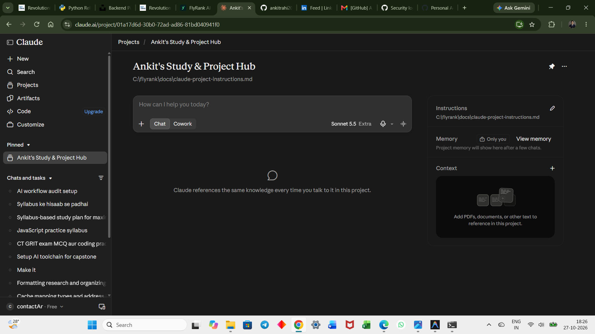
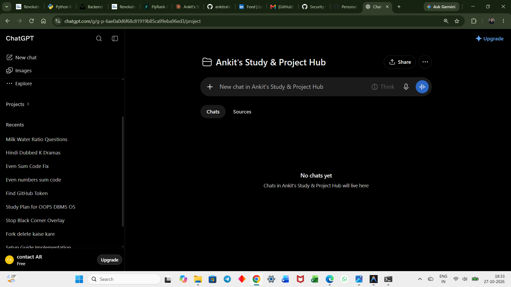
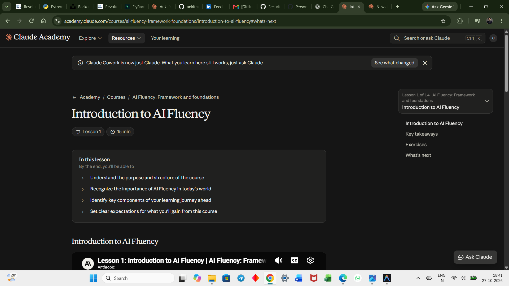

# Tool Setup Checklist — FL-01

> **Status key:** ✅ Done · ⏳ Pending

---

## 1. AI Tool Accounts

| Tool | Account created | Evidence |
|------|----------------|----------|
| **Claude** (claude.ai) | [x] done — 2026-10-27 |  |
| **ChatGPT** (chat.openai.com) | [x] done — 2026-10-27 |  |
| **Anthropic Academy** (academy.anthropic.com) | [x] done — 2026-10-27 |  |

---

## 2. AI Fluency: Framework & Foundations — Course Enrollment

| Milestone | Status | Evidence |
|-----------|--------|----------|
| Enrolled in "AI Fluency: Framework & Foundations" | [x] done — 2026-10-27 |  |
| Module 1 completed | [x] done — 2026-10-27 |  |

---

## 3. Claude Project Setup

| Step | Status | Evidence |
|------|--------|----------|
| Claude Project created with custom instructions | [x] done — 2026-10-27 |  |

The custom instructions are in [`docs/claude-project-instructions.md`](claude-project-instructions.md).

---

> **Note on PDF export:**  
> A PDF export of `docs/workflow-audit.md` was requested. No automated PDF tooling (e.g., `pandoc`) was available in this environment without additional setup. To produce `docs/workflow-audit.pdf`, you can:
> - Open `docs/workflow-audit.md` in VS Code → right-click → "Open Preview" → Print → Save as PDF, or
> - Run `pandoc docs/workflow-audit.md -o docs/workflow-audit.pdf` if you have Pandoc installed.
